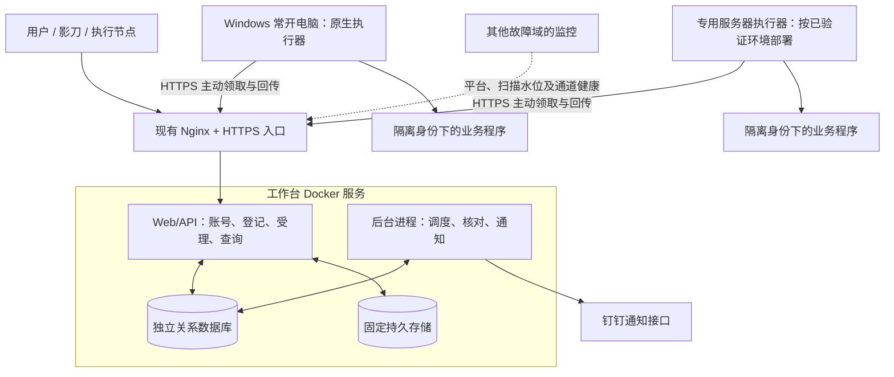

# 工作台 Docker 部署适配说明

日期：2026-09-16。状态：部署设计 v0.1；不是已经生成或验证的部署脚本。实际配置、镜像和目标服务器未部署。

## 1. 已检查的依据与限制

源目录：`C:/Users/JIE/Desktop/服务docker部署/服务docker部署`。已读取《部署文档.docx》的正文，逐张查看全部 10 张嵌入图片；只读检查 `smart-travel-mvp（参考的项目）` 的根 Dockerfile、构建脚本、Compose、package 信息、部署 runbook，以及独立 agent 核查的必要源码。

Word 图示的历史构建/启动成功不等于当前环境已验证。本轮从文档包提取原始图片查看，没有进行 Word 整页排版渲染，不引用未经核实的页码。未复制正文及截图里的真实凭据，未尝试登录或验证其有效性。参考配置和截图确含明文凭据，应由原项目负责人核实是否仍有效及是否需要轮换；本轮不修改。

| 已知事实 | 证据位置 | 对工作台的影响 |
| --- | --- | --- |
| 本地构建并推送内部仓库，再由服务器拉取 | Word 打包与更新步骤；`dockerBuild.sh:3–8` | 复用交付流程；新项目构建和推送拆开，构建不自动触发外部发布 |
| 服务器使用共享 Compose 文件，按服务更新 | Word 服务器操作段及图片 6、7、9 | 仅提供目标服务配置，不覆盖整份已有部署文件，不执行整栈停止 |
| Nginx 通过路径前缀转发至服务端口 | Word 图片 8、10；参考环境 `APP_BASE` | 前端资源、API、登录回跳、Cookie 路径和文件链接均需支持前缀 |
| 根项目是 Node 22 单应用镜像，SQLite 数据挂载到 `/app/data` | Dockerfile、根 Compose、`src/database.js` | 可借鉴部署习惯；不沿用该业务库和内存定时实现作为任务调度模型 |
| 根 Compose 用相对数据目录，而 runbook 强调固定独立目录 | Compose 挂载行；`docs/deployment-data-runbook.md` | 工作台必须明确固定存储位置与实例标识，防止启动到意外空库 |
| 根项目缺 `.dockerignore` 和依赖锁文件；Compose 无健康检查 | 文件检查、Dockerfile 安装分支、Compose | 新项目补齐构建上下文排除、依赖锁定和分层健康；不能据此断言参考秘密已经进入镜像 |
| demo 混有其他系统的配置和缺失依赖 | demo Dockerfile/Compose 与目录核对 | 不作为可直接构建模板，不复制其宿主进程权限或其他应用配置 |

本机只读结果：Docker 客户端 29.6.1，Compose v5.3.0；`docker version` 连接 Linux 引擎管道失败，单独检查退出码为 1。只能证明工具存在，不能证明引擎、镜像构建或容器网络可用。未启动/修改 Docker Desktop，未配置镜像源，未拉取、构建或推送镜像。服务器 OS、架构、Docker/Compose 版本和资源仍未实测。

## 2. 一期目标拓扑

建议先采用一个控制服务代码库，Web/API 与后台进程可以使用同一个镜像、不同启动角色，数据库独立服务。是否单独提供静态前端容器由 M0 技术决策确定；不为一期强加 Kubernetes、Redis 或消息队列。

平台 Docker 化不要求所有业务程序同时容器化。Windows 专用程序使用原生受管执行器；Linux 后台程序可使用经验证的独立运行环境或执行器镜像。nine 能否迁到 Linux 需验证依赖、路径、字体/文件行为及恢复状态，不能仅凭 Python 语言认定已兼容。

控制服务、执行器管理身份、任务身份和业务连接分开。任务不能访问平台数据库管理连接、节点身份或钉钉秘密；不能只靠虚拟环境宣称隔离。默认不挂 Docker 管理 socket、不使用宿主 PID 命名空间、不挂整台宿主目录。未来如支持动态任务容器，应单独设计受控管理边界，不在普通业务脚本中授予容器管理权限。

## 3. 与现有运维的接法

默认交付独立的 Compose 配置及“可追加到共享 Compose 的目标服务片段”，M0 与运维选定现场采用方式：

1. 现场要求共享 Compose 时，只追加工作台服务、唯一命名的网络/卷及必要配置；检查合并结果，仅拉取/更新指定服务，既有业务容器及持久数据保持独立。
2. 允许运维采用独立 Compose 项目时，用单独项目名和部署目录，代理按约定网络或受限端口接入。不能假设两个不同项目里同名网络自然互通。
3. Nginx 路径和端口须由运维分配，不能直接复用参考应用的端口、路径或容器名。代理是否保留路径前缀与应用 `base path` 必须一致；TLS、可信转发头、登录重定向和外部节点地址一起验证。

文档中的 HTTP 私有仓库和第三方镜像源配置属于现场历史做法，不自动复制到开发机或服务器。M0 核实可用仓库、安全访问和证书；若必须使用已有受限内部 HTTP 仓库，由运维明确网络边界，不能为了拉取失败全局关闭证书校验。此项不等于已批准新网络或仓库改造。

平台数据库不向业务电脑公开端口。节点主动连接工作台，尽量不开放电脑入站管理端口。公网、内网、VPN 和访问名单以现场核实为准。

## 4. 开发阶段就必须具备的部署能力

| 能力 | 必需设计与验证 | 工作包 |
| --- | --- | --- |
| 可重复构建 | 固定基础镜像与依赖版本、保留发布清单及来源许可证；`.dockerignore` 排除 Git、秘密、输入、日志、备份和业务数据；验证最终层不含敏感文件 | M1.1 |
| 启动顺序 | 数据库就绪后初始化/迁移，再启动依赖服务；并发启动不重复迁移；应用运行中仍要处理数据库短暂不可用 | M1.1/M6.2 |
| 健康与重启 | 存活、就绪、后台扫描水位分别检查；配置健康检查不等于自动修复业务停摆；重启策略不能代替故障检测 | M1.1/M4.3 |
| 秘密注入 | 仅把必要秘密提供给指定服务，优先受控文件方式；源秘密文件、权限、备份和解密材料独立管理；不得把 Compose secrets 当作自动加密的秘密库 | M1.1/M1.3 |
| 系统权限与资源 | 非 root、明确可写目录、必要能力、进程/内存/CPU 限额、日志轮转、磁盘水位；限制值按容量档案确定 | M1.1/M2.1/M6.3 |
| 受控停止 | 停止新领取，落盘关键状态，处理在途进程及未知结果；停止宽限和任务超时分开 | M2.3/M6.2 |
| 发布隔离 | 镜像不可变标签/摘要，平台镜像版本与业务程序版本分别管理；开发/测试/生产凭据及节点分开 | M1.1/M6.1 |

Docker 官方文档说明，容器启动不代表依赖服务已就绪，应使用健康条件表达就绪依赖；秘密可以按服务挂载文件；构建上下文需用 `.dockerignore` 明确排除。此处只将这些机制用于设计，不代表现场版本已经支持并验证全部配置：[启动依赖](https://docs.docker.com/compose/how-tos/startup-order/)、[Compose secrets](https://docs.docker.com/compose/how-tos/use-secrets/)、[构建上下文](https://docs.docker.com/build/concepts/context/)。

## 5. 持久数据与恢复

| 数据 | 存放与恢复原则 |
| --- | --- |
| 平台关系库 | 固定独立存储；备份配置、运行/attempt、计划游标、去重键、资源占用、审计及待发告警 |
| 程序版本包 | 不可变包及校验值；被历史或待恢复运行引用时不清理 |
| 输入、结果与日志 | 批次和授权隔离；日志保留与关键输入/恢复材料分别配置 |
| 执行器本地记录 | 启动意图、回传记录、离线缓冲、运行目录位于持久位置；保留节点身份与机器关联 |
| nine 业务恢复状态 | 编号文件、原 run_id、请求响应记录及输入必须保留；正式上传先固定节点和互斥范围 |
| 凭据解密材料 | 与数据备份分别受控保管并验证可恢复；不能只备份加密数据库而丢失密钥 |

备份必须包含一致性和保留策略，并有一份位于原主机故障域之外。多类存储不必伪称全局原子快照，但要记录恢复点并能对账。恢复较旧状态时默认禁止调度，核对节点存活进程、外部已成功写入及编号后才能恢复派发。

## 6. 发布、升级与回退顺序

拟议流程：完成测试和发布包 → 获得该次推送/部署授权 → 分发固定镜像 → 暂停新派发并核对在途任务 → 一致性备份 → 按兼容计划迁移/更新指定服务 → 检查就绪、基础路径和无副作用冒烟 → 校验代理配置后按需重载 → 恢复已批准计划并观察。

首次新增 Nginx 路由应在目标服务可用后切入；已有路由更新按实际变更决定是否需要重载。参考文档的 `nginx -t` 和定向更新方式可作为流程依据，不在本轮执行。

回退不能只有“换旧镜像”：发布清单须列出应用、执行器协议、数据库结构和配置的兼容范围。数据库已发生不可逆变更或业务已对外写入时，旧镜像/旧库不保证安全；应使用预先验证的兼容迁移、修复或核对补偿方案。普通发布禁止删除持久卷、重置编号状态或整栈停止其他业务。

## 7. 新增 Docker 验收场景

均为计划，全部未执行；详细步骤和阈值在对应工作包编码前展开。

| 编号 | 场景及预期 | 工作包 | 状态 |
| --- | --- | --- | --- |
| DEP01 | 目标 OS/架构、引擎、Compose、仓库、网络、目录权限与容量登记并验证，不把客户端存在视为可运行 | M0.1/M6.1 | 未执行 |
| DEP02 | 干净环境固定版本构建；上下文、镜像层与最终文件不含凭据、真实数据或个人依赖 | M1.1/M6.1 | 未执行 |
| DEP03 | 合并 Compose 后变量、卷、网络、端口和服务名无冲突；非秘密校验不输出真实配置值 | M1.1/M6.1 | 未执行 |
| DEP04 | 数据库延迟启动、迁移失败及重启时服务正确等待或拒绝就绪，不以空库继续提供错误业务 | M1.1/M6.2 | 未执行 |
| DEP05 | 重建容器及宿主重启后用户、计划、运行、版本、输入和恢复状态保留；错误挂载被识别 | M1.1/M6.2 | 未执行 |
| DEP06 | HTTPS 子路径下登录、刷新、静态资源、API、日志及文件链接正常；Cookie/重定向和节点访问正确 | M6.1/M6.4 | 未执行 |
| DEP07 | 更新本项目不停止既有服务、不覆盖其配置或卷；未授权调用和业务程序越权被拒绝 | M6.1/M6.4 | 未执行 |
| DEP08 | Web 存活但扫描停止、主机故障、磁盘压力和通道故障可由独立监控发现 | M4.3/M6.3 | 未执行 |
| DEP09 | SIGTERM/受控停止、断网及在途长任务升级后保留核对证据；旧执行器不误执行新协议 | M2.3/M6.2 | 未执行 |
| DEP10 | 使用固定发布包演练回退和异机恢复；旧备份恢复默认禁派发，外部写入/编号核对完成才恢复 | M6.2/M6.4 | 未执行 |

本说明仅建立部署约束和验收标准，具体命令应在 M0 确定技术和目录、M1/M6 创建并验证交付文件后生成，避免现在给出指向不存在服务的“可执行部署命令”。
