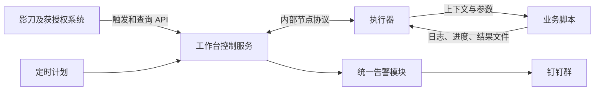

# 工作台接口与运行协议草案

版本：v0.1，2026-09-16；设计草案，尚未实现或冻结。

配套文档：[系统架构](系统工作台架构方案.md)、[开发接入规范](脚本与程序开发接入规范.md)。

本文回答“开发者具体如何与工作台交互”。已有接入规范说明开发及交付要求，但尚不足以替代精确的 API、字段、错误码和协议版本文档。以下路径、字段、文件名和 SDK 方法均为拟议契约示例，不能当成已存在接口调用。

## 1. 已明确的责任边界

任务钉钉告警只能由工作台统一处理。业务脚本不持有钉钉机器人凭据，不选择通知群，不发送工作台任务告警，不实现通知重试。程序发现业务异常时报告事实，平台决定状态、严重程度、接收人、合并策略和通知时机。

即使脚本无法启动、崩溃或机器离线而无法主动报告，执行器和控制台仍负责监测。主动上报是增强可观测性，不取代进程与节点监控。

开发者不需要自建 HTTP 服务、调度循环或节点心跳。不强制给已有程序加入主动网络上报，也不允许业务脚本直接修改工作台数据库。

## 2. 三类接口分开

| 类别 | 谁调用谁 | 主要能力 | 凭据与权限 |
| --- | --- | --- | --- |
| 外部触发 API | 影刀或获授权外部程序 → 工作台 | 带参触发任务、查询运行状态及授权结果摘要 | 外部调用方身份，只能操作授权任务及运行 |
| 程序运行协议 | 被调度脚本 → 本机执行器 | 读取上下文、输出日志、报告进度和业务结果 | 本次运行的本地文件/IPC权限；没有平台管理权限 |
| 执行器内部协议 | 执行器 ↔ 控制服务 | 领取任务、心跳、状态回传、取消、日志和产物管理 | 节点身份、运行归属与领取代次，不向普通脚本开放 |

业务脚本需要触发其他任务属于外部调用能力，必须另行授权，不能因为被调度运行就自动拥有再次派发任务的权限。



## 3. 外部触发 API 草案

### 3.1 触发任务

拟议接口：`POST /api/v1/tasks/{task_id}/runs`。

经 HTTPS 和调用方鉴权，校验任务授权、参数、输入批次及事件编号。只允许业务参数，不接受任意命令、程序版本、节点、凭据、运行编号或越权的 operation 覆盖。

拟议请求示例，仅作说明：

```json
{
  "event_id": "example-download-batch-001",
  "input_batch_id": "example-input-batch-001",
  "parameters": {"period": "2026-07"}
}
```

- event_id：调用方对同一业务触发请求生成的稳定标识，网络重试时保持不变。
- input_batch_id：已登记的输入批次，不是调用方任意提供的机器路径。不需要文件的任务可按任务定义省略。
- parameters：按任务参数定义校验，允许覆盖哪些字段由任务授权控制。
- operation、程序版本、目标连接及节点范围来自任务配置，不能在普通参数中偷偷提升权限。

受理记录、参数快照、事件去重及运行/等待记录提交成功后返回受理结果。示例：

```json
{
  "request_id": "example-request-001",
  "run_id": "example-run-001",
  "accepted": true,
  "deduplicated": false,
  "state": "queued"
}
```

拟议首次受理返回 202；同一调用方及同一 event_id、同一请求内容重复请求返回原 run_id，deduplicated=true，可返回 200。同 event_id 用于不同任务或不同内容时返回冲突，不启动第二份程序。输入尚未就绪时按任务策略受理为等待输入或明确拒绝，不把示例 queued 当作固定返回值。

不同事件 ID 仍需进行业务批次去重。重复请求查询当前运行状态，HTTP 受理成功不表示脚本成功。定时触发直接走同一内部受理逻辑，使用同样的参数校验和业务去重规则，无需伪装为外部 HTTP 请求。

### 3.2 查询运行

拟议接口：`GET /api/v1/runs/{run_id}`。仅允许查询授权范围内的运行。

拟议响应覆盖：运行与任务标识、触发来源、计划/受理/开始/结束时间、调度状态、进程状态、业务结果、观测异常、脱敏错误摘要、产物摘要、日志与归档完整性。

各状态字段枚举及允许转换需要在 OpenAPI 和状态表中冻结；不能用一个 success 布尔值替代失败、部分完成、结果未知、停止待确认等区别。查询接口默认不返回原始账单、真实凭据、内部文件路径或全量日志。

### 3.3 错误与重试语义

| 拟议 HTTP 状态 | 语义及调用方行为 |
| --- | --- |
| 400/422 | 请求格式或业务参数非法；修正内容后使用正确的请求身份，不盲目重复 |
| 401/403 | 身份无效或无权限；解决授权问题，不靠重试绕过 |
| 404 | 资源不存在或按策略不可见，不泄露其他项目资源 |
| 409 | 相同事件标识内容冲突或任务状态不允许，查询并核对 |
| 429 | 限流或受理容量不足，按返回等待信息有限重试 |
| 5xx/网络超时 | 受理结果可能未知；保持原 event_id 和原请求内容查询/重试，不能另造事件编号 |

错误体应有稳定 code、脱敏 message 和 request_id。脚本内部业务接口失败与工作台受理 API 失败是不同事件，不能混为同一重试策略。

输入批次登记/上传、产物获取、取消及恢复 API 尚待详细设计。本草案不通过任意 URL 或任意本地路径绕过这些边界；首批输入也可通过已授权节点的受控目录适配交付。

## 4. 脚本如何接收参数

新程序推荐接收执行器生成的只读上下文文件；文件权限限定到对应运行身份。入口参数名候选为 `--context-file`，但旧程序可保持原命令行参数，由执行器适配。

上下文语义沿用开发规范：run_id、attempt_id、operation、business_key、parameters、input_manifest、output_dir、state_dir、connection_binding。增加 protocol_version 表示协议版本；具体 JSON Schema 随详细设计冻结。

业务日期按平台已经解析的值使用，不因执行当天变化重新计算。上下文不能包含节点注册密钥、钉钉凭据或平台管理员令牌。业务连接的引用不是可任意查询密钥的授权，注入读取方式需限制到该任务所需权限。

本地单独调试使用合成上下文和测试连接，不生成或冒用真实平台运行身份。进入平台后，运行与尝试编号只能由平台提供。

## 5. 脚本如何报告日志、进度和结果

### 5.1 推荐的一期方式：本地协议，由执行器转发

跨语言公共基础采用标准输出/错误输出加本地结构化文件。新程序可使用薄 SDK 简化读取与写入；未使用 SDK 的 Java、Node.js、EXE 等也可以遵循同一文件格式。平台暂时断网不应迫使业务脚本承担中央 API 的网络重试。

| 能力 | 最小实现 | 增强实现候选 |
| --- | --- | --- |
| 日志 | stdout/stderr，执行器持续采集 | 结构化日志，由执行器关联本次运行 |
| 阶段与进度 | 可以暂不提供 | 单写入方的进度 JSONL 文件或受控本地 IPC |
| 最终业务结果 | 既有可靠退出码及经验证适配 | 原子发布本次尝试的 result.json |
| 停止请求 | 执行器管理进程及进程树 | 脚本在安全停点读取执行器提供的取消标志 |

本地协议不是让脚本写控制台数据库。各文件位置由执行器指定并隔离，每次 attempt 使用独立位置，防止读到上一次残留的成功报告。脚本无权借上报内容声明别人的 run_id 或改变节点身份。

### 5.2 进度事件示例

进度文件中一行一个 JSON，UTF-8，单写入方维护单调递增的 sequence；字段示例仍为草案：

```json
{
  "protocol_version": "1",
  "run_id": "example-run-001",
  "attempt_id": "example-attempt-001",
  "sequence": 1,
  "type": "progress",
  "stage": "validate_input",
  "completed": 3,
  "total": 10,
  "message": "已检查3个输入文件"
}
```

执行器按运行、尝试和序号去重，校验类型、长度、大小和计数范围；总量未知可不提供 total，不伪造百分比。阶段进度不是节点心跳，也不能直接把工作台状态改为成功。

半行数据等待完整后读取；运行结束后仍残缺的记录标记为遥测缺失。并发线程/子进程通过单一受控写入入口汇总，不同时无锁追加；日志/进度有配额和截断标记，不无限增长。实际配额与单条长度在实现前冻结。

### 5.3 最终结果及进程证据

结果字段和 success/failed/partial/unknown/canceled 语义以[开发接入规范第5节](脚本与程序开发接入规范.md)为同一来源，不再维护第二套结果定义。

结果临时文件写完整后，在同一目标目录内原子发布为最终文件；运行中只上报阶段，最终结果在全部业务子任务结束后生成。生成结果不等于进程已经正常退出，执行器仍要结合退出码、产物和运行身份核验。

结果宣称成功但进程随后失败、报告编号错误、旧文件残留或成功判据要求的业务产物缺失时，不判业务成功，也不能据此自动重新上传。可选产物缺失或归档失败单独标记，不因此否定已经确认的业务结果或重跑业务。迟到报告按状态核对流程处理，不覆盖其他执行尝试。报告落盘失败时保留可采集错误并非正常成功退出；实际业务写入可能已完成的情况应标记待核对。

### 5.4 可提供给开发者的 SDK 外观

拟议 SDK 只做本地协议封装，以下是说明用伪代码，不是现有库或可运行示例：

```text
context = runtime.read_context()
runtime.log("开始处理本批数据")
runtime.report_progress(stage="validate_input", completed=3, total=10)
... 执行原有业务逻辑，并在安全边界检查 runtime.cancel_requested() ...
runtime.write_result(status="success", summary="已完成约定操作", artifacts=[...])
正常成功退出

发生已知业务失败：写失败摘要并非零退出
外部写入结果不确定：写 unknown 摘要并非零退出，不能仅因上报失败再次提交业务请求
```

SDK 不包含 send_dingtalk、设置告警接收人、领取别的任务、发布程序或读取任意凭据的能力。SDK 内部可处理本地写入和格式校验；业务异常不得被 SDK 静默吞掉。

SDK 或结果文件也不能保证发现脚本隐藏的业务错误。开发者仍负责业务校验；执行器负责独立发现崩溃、退出、超时和失联。

### 5.5 如果以后确需脚本主动 HTTP 上报

可按实际需求增加独立上报适配，但一期不把它作为所有程序的前提。必须使用仅限本次 run/attempt 的短期权限、上报事件去重、内容限制、有限重试和离线缓冲；不得复用节点注册令牌或管理 API。

localhost HTTP 也不是天然安全边界；若采用本地服务，应限制监听范围、身份及调用权限，不能让其他进程任意修改运行状态。本期优先文件协议，避免为简单脚本增加常驻 Web 服务。

## 6. nine 的最小接入方式

1. 工作台按任务授权接收事件参数或生成定时参数。
2. 执行器把上下文映射为 nine 已支持的账期、输入、配置及 run_id 等参数；操作模式绑定到已授权任务。
3. 执行器捕获 stdout/stderr 和退出码，收集已知的预检清单及上传记录；不要求 nine 调用中央 HTTP API。
4. 平台根据执行模式区分预检通过与正式上传完成，失败后统一产生钉钉告警。
5. 需要更细进度时，再通过适配器或少量改动输出本地进度/结果。适配器不能从模糊日志推断不存在的业务成功证据。

这条路线保留既有业务代码。固定节点、共享编号串行、原 run_id 恢复、确认及外部写入核对规则仍然生效。未改造或运行 nine。

## 7. 对外交付文档还应补齐什么

| 文档/资源 | 当前状态 | 作用 |
| --- | --- | --- |
| 开发接入规范 | 已有草案 | 明确开发及交付要求 |
| 本接口与运行协议草案 | 本轮新增 | 区分调用对象、边界和推荐通信方式 |
| 外部 API OpenAPI 文件 | 尚未生成/冻结 | 精确端点、鉴权、请求响应、错误、版本兼容及限流规则 |
| 运行上下文与事件/结果 JSON Schema | 尚未生成/冻结 | 机器可校验的类型、枚举、长度、必填及兼容规则 |
| 程序包/入口登记格式 | 尚待冻结 | 告诉平台如何部署和启动具体版本 |
| 可运行最小示例与契约测试 | 尚未实现 | 验证程序和执行器真实兼容 |
| 可选语言 SDK/模板 | 尚未实现 | 减少重复接入代码，不绑定单一语言 |

应先冻结最小契约，再让开发者按示例接入。脚本对接文档不包含节点注册、管理员 API、钉钉 Webhook 或平台数据库连接信息。

## 8. 协议验收场景

以下均为设计场景，未实现、未执行。

| 编号 | 场景与预期 | 状态 |
| --- | --- | --- |
| P01 | 未实现钉钉代码的程序启动失败、崩溃或业务失败，平台仍可识别并告警 | 未执行 |
| P02 | 外部触发响应丢失，同 event_id 重试返回原运行；同编号不同内容冲突 | 未执行 |
| P03 | 事件和定时带相同业务参数进入同一内部受理及去重逻辑，旧程序无需 HTTP 上报 | 未执行 |
| P04 | 脚本不能用上报接口触发其他任务、访问别的运行或取得节点/钉钉凭据 | 未执行 |
| P05 | 中央连接断开时，脚本日志和本地报告由执行器按既定策略缓存；不触发重复业务写入 | 未执行 |
| P06 | 进度重复、乱序、半行、错误编号和容量超限被识别，不改写其他运行或伪造成功 | 未执行 |
| P07 | 结果已写成功但进程失败、残留旧结果或必需业务产物缺失时不判成功；可选产物/归档失败单独记录，不触发业务重跑 | 未执行 |
| P08 | 使用/不使用 SDK 的实现遵循同一格式；未知协议版本拒绝或进入明确兼容路径 | 未执行 |
| P09 | 输入未就绪、受理容量满、权限不足或非法参数返回明确结果，已受理请求不会静默丢失 | 未执行 |
| P10 | 协作取消和强制停止分别核对，不能将取消标志或结果上报当成外部事务回滚 | 未执行 |

## 9. 版本与本轮交付边界

本轮仅新增接口设计文档并同步职责表述，没有创建 HTTP 服务、SDK、OpenAPI 实现、机器人或自动任务，没有执行真实接口调用。

文档核验使用 `python -`，退出码 0：三份配套文档链接、UTF-8、围栏和空白检查通过，4 个 JSON 示例可解析，P01–P10 保持未执行，原有 12 项程序验收和 43 项架构验收保留。独立 agent 快审后修正了“可选产物缺失不能误判业务失败”的表述；此为文档一致性检查，不是接口契约测试通过。

协议需有明确版本；新增可选字段与破坏性变更分别管理，未知必需版本不静默执行。草案冻结、实现、契约测试、目标环境接入及业务验收是不同阶段，不混称“接口已完成”。

文档自检不等于开发自测确认、人工代码评审、CI 验证或发布审批通过。
