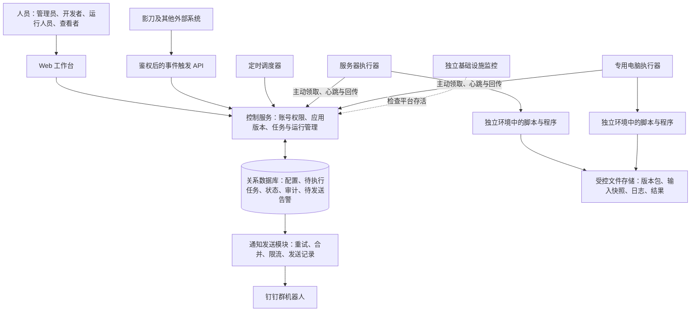

# 自研自动化程序工作台：一期架构方案

状态：架构草案，供范围确认；未实现、未部署、未调用外部系统。
编制日期：2026-09-16。
修订：v0.3，明确 Docker 部署，实施顺序更新为 M0–M6。故障追问见同目录《架构复核与追问记录.md》；当前工作包与部署依据见《实施计划与工作包.md》《Docker部署适配说明.md》。

## 1. 目标、事实与边界

### 已确认需求

- 统一管理多人开发的自研自动化脚本与程序，兼容不同语言、依赖和运行环境。
- 事件触发与定时调度均为一期核心能力，均支持入参。
- 影刀下载完成后可作为外部调用方触发任务；不接管影刀任务、机器人或调度平台。
- 业务处理、业务结果生成和外部系统上传逻辑留在脚本内部。
- 平台负责执行调度、运行状态、日志、异常监测、责任追踪和钉钉群告警。
- 有可常开服务器和电脑，可以部署平台与专用执行节点。
- 需要多人账号、权限和执行节点在线监控。
- 工作台最终使用 Docker 部署；Windows 等执行电脑按已验证运行环境独立安装执行器，不要求所有业务脚本容器化。

### 已检查的实际基础

- 初次检查时工作目录为空、非 Git 仓库，没有既有系统需要迁移。2026-09-16 根据用户授权初始化本地 Git 仓库，分支为 main；未提交、未设置远程、未推送。
- 样例目录 `C:/Users/JIE/Desktop/拼多多/nine` 包含两个命令行 Python 程序：账单核对报表生成、账单明细预检及上传。二者分别读取原始账单，不能默认将报表输出接到上传输入。
- 样例上传程序支持账期、配置、输入目录、run_id 等参数，以及预检和正式执行两种模式。
- 上传依赖本地递增编号状态文件、批次请求与响应记录；恢复运行依赖原 run_id 和原始数据。
- 当前代码未见跨进程编号锁；正式接入时先固定上传节点，对共享编号状态及目标表的任务串行执行。
- 现有项目规范要求确认 manifest 后执行正式上传。一期保留该能力；是否对某个任务放开无人确认上传属于业务决策，不在通用平台中默认放开。

### 本轮交付边界

此前已按授权初始化 Git 仓库并形成架构与接入草案。本轮只读检查用户提供的部署项目、Word 正文及全部 10 张图片，新增实施工作包和 Docker 适配说明；不编写运行系统，不修改样例脚本，不创建账号或钉钉机器人，不触发上传或部署。

一期以可通过命令行无交互启动的程序为验收范围。需要浏览器的程序可声明浏览器能力；必须操作真实桌面的程序需另行验证交互会话条件，不能因为执行器是 Windows 服务就认定支持无人值守桌面操作。

## 2. 总体架构

建议一期采用模块化单体控制服务、关系数据库、受控文件存储和独立执行器。调度循环和通知循环可以同一代码库中的后台进程运行。

任务队列先以数据库中的持久化记录实现，通过事务和唯一约束防止重复领取、重复触发；暂不强制引入额外消息中间件。后续确有吞吐或隔离需求再扩展。

生产脚本由执行器启动为受管理的子进程，不在 Web 请求线程内运行，也不载入控制服务进程。即使部署在同一台服务器，也应使用不同的系统身份、工作目录和必要的资源限制。

## 3. 一期页面与模块

| 页面/模块 | 核心内容 |
| --- | --- |
| 工作台总览 | 正在运行、待执行、失败、延迟、节点离线、待确认、告警发送失败 |
| 应用与版本 | 程序用途、负责人、不可变版本包、入口、参数定义、环境要求、结果说明 |
| 任务管理 | 绑定版本、参数、运行节点组、账号引用、超时、并发、业务去重和失败策略 |
| 定时计划 | 时区、周期、固定及动态参数、下次触发预览、暂停、错过时间的处理 |
| 事件接入 | 调用方、可触发任务、参数权限、事件编号、接收记录、重复请求结果 |
| 执行节点 | 在线情况、最后心跳、版本、能力、运行槽位、当前任务、维护状态 |
| 运行中心 | 触发来源、参数快照、时间线、尝试记录、日志、退出码、结果入口、取消和恢复 |
| 连接与凭据 | 业务凭据引用、授权使用范围、更新记录；普通用户不能查看密钥 |
| 告警中心 | 通知群、负责人、事件规则、发送状态、失败重试、合并记录、确认与关闭 |
| 组织与权限 | 用户、项目组、角色、任务与运行访问范围 |
| 审计记录 | 登录、发布版本、变更计划、触发、取消、授权、密钥更新和结果下载 |

“机器人管理”在页面上建议称为“执行节点”，卡片中标识执行器状态，避免与影刀机器人及钉钉机器人混淆。

## 4. 账号与身份体系

### 4.1 人员账号

一期建议内部邀请或管理员创建账号，不开放公众注册；按项目组隔离资源。预留接入公司统一身份认证的位置，不先假定已有企业登录系统。

| 角色 | 默认权限边界 |
| --- | --- |
| 平台管理员 | 管理人员、节点、全局配置和授权；敏感操作留痕 |
| 项目管理员 | 管理本项目成员、任务和资源授权，按授权发布版本 |
| 开发者 | 登记程序、维护参数和上传待发布版本，查看获授权的日志 |
| 运行人员 | 启动、暂停计划、取消或按策略恢复获授权任务，不随意修改程序 |
| 查看者 | 查看获授权的任务与运行摘要；敏感日志和结果下载单独授权 |

上述为角色模板，具体能力由权限控制。修改任意程序代码实际上可能使用其运行凭据，因此“上传版本”“发布生产版本”“使用高权限凭据执行”不能只靠按钮隐藏来隔离。发布与凭据使用权限应共同校验。

本地账号密码使用成熟的密码哈希方案保存；登录限速、会话到期及撤销、后台鉴权、文件访问鉴权列为实现门禁。具体认证组件待技术选型确定。

人员账号与长期运行任务的所有权分离：正式任务属于项目，以受授权的自动化身份运行，同时记录创建人及负责人。负责人停用时必须指定接替人或显式暂停无人负责的任务，不把停用个人账号当成所有计划自动获得或失去业务授权。

账号停用、角色收回、程序版本禁用、连接授权撤销在后端生效。已受理任务保留原始快照，但启动前重新校验当前发布及资源授权；失去授权的排队任务转为阻断，不按历史权限继续执行。已在运行的任务按撤销类型记录停止或隔离请求；撤销平台凭据不能证明已启动进程或其外部授权立即失效。

首次管理员通过一次性本地初始化流程建立，不内置通用默认密码；账号恢复走管理员核验与审计。使用浏览器会话时配置安全 Cookie 及 CSRF 防护；管理入口通过 HTTPS 和受控网络访问。

### 4.2 执行器身份

每个节点有独立、可撤销的注册凭据，只能领取授予本节点组的任务并回传对应运行的数据。节点凭据不是人员密码。

一次性注册凭据用于换取节点运行凭据，二者分开；通信使用 TLS 并校验服务端证书。撤销或隔离节点后停止新派发，记录其在途运行和已授予的业务凭据，按风险核对停止及凭据轮换，不能直接释放旧运行占用的上传资源。

执行器的操作系统账号采取最小权限。节点在线不代表 Windows 用户桌面可操作，也不代表业务系统凭据有效。

### 4.3 外部调用方身份

影刀或其他外部系统各有独立服务凭据，仅能触发指定任务、查询自己被授权的运行和传入允许的参数。支持凭据轮换、请求追踪和调用限流。

调用接口不能传任意 shell 命令、任意程序路径或越权的账号引用。参数按类型校验，通过参数数组或 JSON 文件传递，不拼接执行命令。

### 4.4 业务连接与凭据

接口密钥、数据库连接、浏览器会话等以连接引用绑定任务，并限制允许使用的项目、程序版本和节点。执行时按需提供，避免敏感值出现在命令行、任务快照、日志或群消息中。

数据库中的加密内容与加密密钥分开保管。浏览器会话的有效性只能体现最近检测结果及检测时间，不能承诺持续有效。

钉钉机器人凭据由通知模块使用，不分发到每个业务脚本。

业务凭据轮换与业务配置快照分开：允许任务使用轮换后的有效凭据，但不能静默改变目标系统、店铺或权限范围；授权范围改变需要重新校验。凭据到期或不可用时显示明确阻断原因。针对恶意代码或主机管理员，日志脱敏和密码界面隐藏不能形成安全隔离。

### 4.5 代码执行信任边界

一期仅接纳部门内受信任、经授权发布的程序，不提供公众上传和运行任意代码的服务。独立工作目录或 Python 虚拟环境只隔离文件与依赖，不等同于安全沙箱。

不同信任域或高权限程序按操作系统身份、专用节点或虚拟机隔离；业务进程不应能读取执行器注册凭据、控制服务配置、其他任务的秘密或修改执行器程序。网络与目录访问采用必要范围授权；需要更强隔离且环境暂不具备时，不将该程序部署到共享节点。

### 4.6 正式上传确认的绑定范围

需要确认的任务以不可变的“发布版本校验值＋实际参数摘要＋输入清单校验值＋目标连接身份＋预检结果”为确认对象，记录确认人、时间、授权和有效期。任何影响业务结果的变动使原确认失效；执行前重新核验。

确认绑定运行或唯一业务执行键；绑定/消费确认和建立正式执行在同一事务完成，不能用一份确认新建多次独立上传。恢复原运行保留确认关联，并核验当前授权、有效期与输入；网络请求重试不要求重复确认，也不新建业务执行。

不把命令参数 execute 作为可由外部调用方随意覆盖的开关。预检、报表及正式上传应绑定获授权的任务操作；正式上传还需通过相应确认策略。通用平台允许对经业务批准的任务配置自动执行策略，但本轮不代表已批准样例的无人值守上传。

## 5. 核心对象与关联

| 对象 | 作用 |
| --- | --- |
| 项目 | 成员与资源权限范围 |
| 应用 | 某一项自动化能力及负责人 |
| 应用版本 | 不可变程序包、校验值、入口、依赖说明、参数结构、状态协议 |
| 任务 | 应用版本与执行参数、节点组、连接引用、运行策略的组合 |
| 触发器 | 定时计划或获授权的事件入口 |
| 数据批次 | 输入文件清单、业务日期、批次标识、完整性及交付状态 |
| 运行 | 一次业务执行，保存版本、参数、输入及策略快照 |
| 执行尝试 | 某次运行在某节点的一次启动、退出或恢复过程 |
| 节点/节点组 | 能力、身份、容量、最后心跳和维护状态 |
| 执行租约/资源锁 | 任务领取所有权及跨任务的互斥资源 |
| 产物 | 日志、结果文件等的受控位置、校验值和保留期限 |
| 告警与投递 | 故障事件及每次钉钉发送的结果 |
| 审计事件 | 人员或系统对关键资源的操作记录 |

平台运行编号与样例程序 run_id 建立映射；一次运行的恢复保留原脚本 run_id，尝试记录使用新的 attempt 编号。运行任务绑定明确版本，发布新版本不改变已排队或已启动运行的快照。

## 6. 参数、触发和调度

### 6.1 统一参数规则

- 应用版本声明参数名称、类型、必填、范围、枚举和默认值。
- 任务定义固定参数；事件触发仅能覆盖明确允许的字段；定时触发可使用受限制的日期模板。
- 参数优先级：获授权的触发参数或模板值 → 任务默认值 → 应用默认值。最终结果整体校验后保存。
- 日期模板按计划的业务时区及计划触发时刻计算。例如补跑 9 月 1 日“上个月”任务，仍按 9 月 1 日的计划时间计算，而非恢复当天。
- 动态参数不允许执行任意代码或表达式。
- 保存实际参数及输入快照；密钥仅保存引用和必要的版本标识，不存明文。

### 6.2 事件触发

外部调用提交任务标识、来源事件编号、业务批次和获授权参数。鉴权、校验和持久化完成后，快速返回受理结果及运行编号，业务执行在后台进行。

同一调用方的同一事件编号只受理一次；相同编号但内容不同应报冲突，不静默采用新参数。事件来源方重试必须复用原事件编号。

受理记录、请求摘要、运行或等待记录与事件去重标识在同一事务中提交后才返回受理成功。运行查询可见受理、等待、运行和最终状态，不把 HTTP 请求成功当成业务成功。超过约定请求重放窗口的旧事件拒绝或转人工核对，事件去重索引保留时间必须覆盖该窗口。

文件必须已交付并校验完成才能运行。服务器不能直接假定自己可以访问其他电脑的本地路径。

### 6.3 定时调度

支持一次性、每日、每周、每月以及高级周期规则；界面展示时区和若干次实际执行时间，让人确认规则。

定时触发以“触发器标识＋计划触发时刻”持久化去重。恢复、重启或未来多实例部署不应重复生成同一计划实例。

扫描器在同一事务内持久化计划实例、运行/等待快照或跳过原因，再推进扫描游标，避免先推进游标造成漏跑。计划修改生成修订版本，记录生效时刻；触发边界由条件更新或锁裁决，明确哪个修订负责该时刻。修订号用于参数追溯，不用于绕开“同一触发器＋同一时刻”的唯一约束。

一期默认采用 Asia/Shanghai 业务时区，内部时间保存为 UTC 并保留时区标识；按月指定不存在的日期默认跳过，月底运行使用明确的月底规则。若支持存在夏令时的时区，必须先明确并测试不存在或重复时刻的处理，不直接继承未核实的调度库默认行为。节点耗时使用单调时钟计算，失联判定使用服务端接收心跳的时间，节点时钟偏移触发环境告警。

每个计划明确错过时间的策略：跳过、仅补最近一次、或有数量与期限上限的补跑。暂停默认影响未来触发；已排队任务是否取消是单独操作，不隐含终止运行中的脚本。

### 6.4 跨触发来源协调

事件去重只能防接口重复请求，不能防同一批数据被定时与事件各上传一次。有副作用操作使用目标业务连接、操作类型及数据批次版本等组成的受控业务去重范围，按实际业务补充店铺、账期等；不能仅用任务 ID 隔离，否则复制任务可绕过去重。也不能只用账期，否则修订数据无法正常处理。业务去重维度须经对应业务确认。

失败后的恢复沿用原业务身份；独立重处理或修订使用获授权的新输入版本或重处理标识，并关联原运行。业务去重事实的保留期独立于普通日志；清理日志不能使已执行的业务被当成新任务。普通执行者无权随意变更去重范围。

跨任务资源互斥用于共享账号、桌面会话、编号文件或目标表。样例上传先对共享编号状态及目标表串行执行；其他独立任务可并发。

共享物理资源采用管理员维护的规范化标识，必要时跨项目统一引用。领取运行、预留节点容量和获取完整资源集合原子完成；无法获得全部资源时不保留部分占用。失联隔离不能仅因租约到期自动解锁；解除需具备权限，并记录原进程已停止及外部结果核对依据。

平台最多保证在约定条件下防止重复受理和并发启动，不宣称外部写入天然具有恰好一次语义。业务幂等及未知写入结果的核对仍需脚本与目标系统共同支持。

### 6.5 等待输入与队列调度

定时任务按计划业务日期和明确的批次选择规则匹配输入，不读取无约束的“最新目录”。未齐套时进入等待输入或按配置失败，设等待截止时间及缺失告警；多个候选批次无法唯一选择时阻断。等待输入不占执行槽位及业务互斥锁。

等待记录先保留计划和参数，批次就绪后再固定输入快照并原子关联业务去重键；若影刀事件已创建同一业务运行，等待记录关联该运行而不另开一份。输入就绪时重新检查权限和完整性。

队列需有项目及节点组容量上限、并发配额和公平调度，避免大量补跑或单一项目长期挤占所有槽位。超出受理容量时返回明确限流或容量不足结果；若已返回受理成功则必须持久追踪，不能静默丢弃。优先级数量和具体配额在容量评估时确定。

## 7. 执行节点与环境

- 执行器主动连接控制服务，注册、发送心跳、领取工作和回传状态。
- 节点报告操作系统、可用运行时、浏览器/软件能力、可访问的数据位置及可用槽位。
- 任务仅发给满足环境、网络、身份及资源条件的节点。不能只按语言匹配。
- 一期可使用预配置的独立运行环境，固定解释器、JRE/Node 等运行时和依赖版本；发布前验证，不在每次执行时安装最新依赖。
- Windows 执行器可作为后台服务启动，但真实桌面操作需独立验证会话机制。
- 每次运行使用独立工作目录；程序版本目录、运行临时目录和持久业务状态目录分开。
- 节点维护模式停止领取新任务，可让当前任务完成后下线。

在线状态、可接单状态和任务状态分开记录。一个在线节点可能因环境缺失、容量满或维护而不可接单。

心跳间隔与失联阈值可配置。初始候选值可为 15 秒心跳、60 秒未收到进入疑似失联、120 秒进入离线；这些只是待环境验证的配置建议，不是已验证的服务承诺。

### 7.1 发布、准备与环境漂移

程序版本经过待发布、已发布、已停用等生命周期管理；任务只能绑定已发布且通过目标环境验证的版本。执行器从获授权位置获取版本包，校验内容摘要，先完整准备运行环境与输入，再原子切换为就绪状态，禁止直接执行半下载的包或开发者正在修改的目录。

依赖清单及锁定信息属于版本验证范围。依赖安装本身可能执行代码，按受控环境发布步骤处理，在隔离身份下运行，禁止改写执行器及控制服务目录；启动前再次核对实际包和环境，不能在原校验后替换内容继续执行。

节点的能力报告需要可验证的环境检查，不能只依靠手工标签。发布记录绑定经验证的运行环境指纹；关键运行时、依赖或节点策略变化后重新验证。校验失败时阻断启动并保留原因。

### 7.2 执行器升级与容量

控制服务与执行器协商协议版本和支持能力；不兼容节点可以继续报告存量运行，但不能领取不兼容的新任务。执行器升级前进入维护状态，排空运行或按恢复方案保留状态，升级失败可恢复原执行器版本。

任务配置 CPU、内存、工作目录空间及日志等资源预算，节点报告可用量；采用可落地的系统限制或专用节点隔离，不能把声明的预算当作已经生效的限制。磁盘不足、环境不可用或协议不兼容时不接新任务。

## 8. 运行状态和异常处理

基本流程：待执行 → 已领取/启动中 → 运行中 → 成功或失败。

另设等待输入、等待确认、重试等待、取消中、已取消、超时、失联待核对等状态。恢复前后的操作写入运行时间线。

| 情况 | 识别方式 | 处理 |
| --- | --- | --- |
| 启动失败 | 执行器创建进程失败 | 保存原因，进入失败并告警 |
| 运行异常 | 退出码及约定的终态报告 | 进入失败；日志辅助定位 |
| 业务校验失败 | 脚本主动返回业务失败 | 显示业务原因，不靠扫描 ERROR 字符猜测 |
| 超时 | 平台及执行器的运行时限检查 | 标记超时、请求停止并确认进程树；未确认停止前不释放互斥资源 |
| 调度延迟 | 计划时间、队列时间和启动时间比较 | 超阈值告警，不要求脚本已经报错 |
| 节点失联 | 心跳与执行租约过期 | 标记结果待确认，不自动断言失败或重派有副作用任务 |
| 人员取消 | 取消请求及执行器确认 | 先取消中，确认停止后已取消；取消不等于撤销外部写入 |
| 控制台重启 | 数据库中的运行与节点状态核对 | 恢复追踪，不重新生成已受理触发 |
| 执行器重启 | 持久化执行记录和进程身份核对 | 核对进程是否仍存活；不能只看 PID，不能盲目启动第二份 |

执行器收到领取租约后按协议确认启动并续约；数据库条件更新防止旧执行器回传覆盖新状态。日志使用运行、尝试和序号关联，重复上传可去重。

每次启动使用唯一 attempt_id 和领取代次；执行器先持久记录启动意图，再创建带可核验身份的进程并记录创建结果。重复启动指令返回原尝试状态，回传必须匹配运行、尝试与领取代次。若崩溃发生在无法证明是否已创建进程的窗口，有副作用任务进入待核对，禁止按“未启动”直接重开。

租约过期并不能杀死原机器上仍运行的脚本。对于上传任务，在确认原进程停止及外部结果前，保持资源隔离并阻止另一节点执行同一业务写入。接入时明确“重新开始”与“恢复原运行”的不同语义。

短时断网时执行器可缓存日志和状态，恢复后补传；缓存设容量上限，上传批次恢复所需记录不得作为普通临时日志清理。断网是否停止正在执行的任务应按任务类别制定策略。

### 8.1 重试与不确定结果

分别配置脚本内部重试、平台再次尝试和通知重试，不把三者叠加成无限循环。任务必须声明副作用类别、可自动重试的错误、次数上限、退避和总时间预算；接口上传默认不做平台整任务自动重试，除非其幂等与恢复协议已经验证。

普通运行超时之外，还要区分排队超时、输入等待超时、启动准备超时和停止确认超时。重试和补跑占用正常容量，不应挤占全部新任务；达到上限后转为明确的终态或待核对状态。

断网期间一期默认不接新任务，已运行程序沿用已声明的离线策略和本地时间预算；有副作用程序不能因网络抖动默认强杀后重跑。未能可靠记录恢复状态时，支持协作式安全停点的脚本应阻断后续写入；仅具备进程接入的脚本按已声明策略请求停止、隔离资源并标记结果待核对，不承诺阻止已发出或在途的外部写入。

### 8.2 业务执行、平台状态和日志完整性

进程终态与关键业务结果先写入执行器本地持久记录，按运行编号、尝试编号和递增事件序号上报；控制端以确认及幂等更新接收，未确认时可以重复发送。不能只在内存中保存“刚刚成功”的结果。

业务执行状态、日志完整性和产物归档状态分别展示。脚本已报告成功但日志上传失败时显示“脚本成功／日志不完整”，不能为了补日志重新运行上传；若业务结果文件本身是成功判据，则文件缺失不能判为业务成功。

进程/调度状态、超时或失联观测事件、业务结果分别保存。取消与完成并发时条件更新并核对实际完成证据，已经完成不能显示为已取消。超时或失联后的可信迟到完成信息进入核对流程，可补记实际结果但不删除原异常时间线；旧代次信息作为核对证据保存，不能直接覆盖当前尝试或诱导再次上传。

stdout/stderr 持续异步排空，限制单条大小、总量和保留期；普通日志轮转或截断时明确记录缺失范围，不能静默丢失。日志管道异常不得阻塞业务进程；若持久恢复记录不能落盘，采用 §8.1 的协作停点或进程停止策略并保留待核对状态，不将进程管理能力等同于业务事务撤销。

## 9. 脚本接入约定

面向开发者的配套文档见[脚本与程序开发接入规范](脚本与程序开发接入规范.md)，其中包含基本要求、新旧程序适配、交付登记和验收场景。具体传输字段为草案，需随平台详细设计冻结；本文的最小接入边界保持不变。

[接口与运行协议草案](接口与运行协议草案.md)进一步区分外部触发 API、脚本本地运行协议和执行器内部协议。一期推荐执行器采集标准输出、退出码及可选的本地进度/结果文件；SDK 仅封装同一协议，旧程序无需主动 HTTP 上报。钉钉任务告警完全由平台负责，不要求业务脚本包含该功能。

### 最小接入

1. 提供无交互启动入口、明确的参数和固定运行环境。
2. 标准输出与错误输出可采集；失败不能吞异常后仍返回成功。
3. 明确各退出码的意义；已有脚本可通过适配器映射。
4. 主程序等待它启动的业务子任务完成，避免主进程结束但业务仍在后台执行。
5. 声明输出位置、最大运行时间、可否取消及安全重试条件。

### 增强接入

可报告阶段、处理数量、业务错误码、结果摘要及产物位置。推荐统一 JSON 事件或结果文件协议；具体传输格式在详细设计时确定，各语言不必共用同一 SDK。

平台的成功判定结合执行模式、进程退出和约定结果。若脚本隐藏业务错误，平台无法仅凭进程监控识别。业务数据是否正确由脚本自己的验证负责，平台不复制计算规则。

样例上传中退出码 0 在预检模式下只表示预检通过，不能显示入库成功。正式上传结果还需根据业务约定判断；客户端收到成功不天然等于服务端数据完整性已核验。

## 10. 文件、凭据和恢复数据

程序包、输入数据、业务配置、秘密凭据、结果文件和恢复状态分别管理。

- 输入批次包含文件清单、校验值、交付完成状态，运行后禁止原地修改；修订形成新批次。
- 结果由脚本生成，平台登记位置或按规则归档；访问需要权限。
- 普通运行日志设置大小与保留期，群消息仅使用脱敏摘要。
- 请求体可能包含业务明细，不作为所有用户可见的普通日志。
- 上传续传记录、编号状态及输入快照的保留期与恢复需求一致，不能因普通日志过期而删除。
- 数据库、程序版本、关键输入及持久状态需要备份并进行恢复验证。单台平台服务器并不等于高可用。
- 从备份恢复编号状态可能落后于目标系统已写入的数据，恢复后必须核对再恢复上传，不能简单回滚编号文件。

### 10.1 文件交付与可见性

外部事件传递已登记的数据批次标识，服务端映射到获授权的存储位置；节点本地输入必须同时绑定节点身份，不能把任意本地路径或任意下载 URL 当作可信输入。

上传或复制过程中使用暂存状态，全部文件写入完成并通过大小、数量及校验值检查后，提交清单并标记就绪；完成标记由有权限的交付方生成，不能仅凭任意同名文件判断齐套。内容不可变由受控存储权限和执行前校验共同保障；可写共享目录不能只靠约定宣称是不可变快照。

版本包及结果文件的解包、读取和下载必须校验解析后的真实路径，限制在授权根目录内，处理路径穿越、符号链接/重解析点、同名覆盖及解压容量。未经验证不提供任意 URL 抓取；确需远程存储时使用管理员登记的连接与范围。

脚本上报的产物路径和日志同样是待校验输入。执行器采集产物时检查最终路径、所属运行及文件权限，禁止借结果上传读取节点凭据或其他任务文件。日志和摘要按安全文本呈现；脚本生成的 HTML 等主动内容默认下载或隔离预览，不能在工作台同源执行。结果下载、预览和详情链接均独立鉴权。

数据库记录和文件存储不假设处于同一事务。文件先完成校验再发布就绪元数据；中断上传或归档通过未完成状态和清理任务对账，运行不得消费孤立或不完整产物。

### 10.2 删除与恢复保护

被运行、待核对事件或恢复流程引用的版本、输入、编号状态和请求响应记录禁止普通清理。应用及任务停用采用逻辑归档，保留历史引用；日志到期后仍保存必要的运行摘要与去重记录。

关键审计由控制服务依据已认证身份生成，记录操作者/服务身份、时间、资源、操作、结果及脱敏变更摘要。普通项目角色和业务执行器无权修改或删除审计；审计保留期限独立于运行日志，授权清理本身留痕。当前方案不宣称能抵抗数据库或主机最高权限管理员篡改，相关权限需组织管理。

备份包括数据库、版本包、关键输入、恢复状态和独立保管的解密材料；明确备份之间的一致性边界。恢复后先进入禁止调度的核对模式，检查恢复点之后是否有外部已受理请求、仍在执行的进程或已经成功的业务写入，再决定补跑及解除资源锁。数据可恢复点和恢复时间目标由业务及运维确认后形成演练门禁。

## 11. 钉钉告警

通知由控制台统一处理。任务状态变化与待发送告警在同一数据库事务中保存，通知发送独立于业务任务执行。

一期告警类型：启动失败、预检/业务失败、最终执行失败、超时、调度延迟、节点失联，以及告警通道发送失败。

脚本自身的内部重试默认记录过程，在耗尽或达到告警阈值后通知，避免每次重试刷屏。节点整体离线可合并一条节点告警并列出受影响任务。

通知内容包含任务、触发来源、脱敏参数摘要、运行编号、节点、耗时、失败阶段、原因、负责人和受控详情入口。手机访问内网详情需要相应网络条件，群摘要应能独立说明问题。

记录发送结果、有限重试、退避、限流和合并。通知重试不得触发业务重新执行。永久失败进入可见的待处理状态，可由有权限人员重新发送。接口受理通知不等于人员已读。

告警事件另有待确认、处理中、已恢复及已关闭等处理状态，记录确认人、处理备注和关闭原因。故障恢复可以更新恢复状态，但不能伪造人工确认；消息投递状态与故障处理状态分别展示。

钉钉机器人类型及权限需结合实际群配置核实；优先评估企业内部应用机器人，不预设所有群均可新建同一种 Webhook 机器人。当前仅核对文档，未连接实际群。

控制台完全宕机时，必须由独立监控发出故障通知；同一个失效通知通道无法可靠告警自身失效，需要独立监控或备用联系机制。

### 11.1 平台组件与告警自身的监测

独立监控不能只检查网页能否打开。调度扫描、通知扫描及状态核对分别记录最近成功时间和处理水位；监控检查其新鲜度，以及最老待执行任务年龄、通知队列积压与最老消息年龄、数据库和存储可写性。即使计划实例尚未生成，也能发现扫描循环停摆；不能依赖已经停止的循环给自己发告警。执行器心跳与任务进程状态分别观察。故障检测时效、通知延迟和未确认升级阈值在对应里程碑开始前明确。

告警按故障事件编号和目标群合并；钉钉请求超时且结果未知时可能重复投递，因此同一事件沿用相同标识，不承诺第三方消息恰好发送一次。恢复消息应与原告警关联并保持可理解的先后顺序；故障再次出现要新建或重新打开事件，避免永久静默。

故障事件、通知消息、发送尝试分别编号；响应丢失时标记送达未知，按有限预算重试。同一通道持续失败时不得递归生成发往该通道的新告警，由独立监控或备用机制处理；恢复后对过期通知附带当前状态，避免只发送已经失效的失败信息。

计划内维护可以在明确范围和到期时间内抑制重复通知，但仍保留异常记录；抑制不自动放开不安全运行。无人确认的告警按授权的负责人及升级规则提醒；人员停用后不能让通知目标无人承接。

## 12. 部署与实施分期

### 一期部署起点

- 一台常开服务器：通过 Docker/Compose 部署 Web、控制服务、调度及通知进程、独立关系数据库和受控持久存储。具备备份和重启恢复方案。
- 一个服务器执行器：承接已验证的后台任务，与控制服务隔离系统身份及资源。
- 一台专用电脑执行器：承接有本地环境要求的任务。
- 独立监控：检查平台可用性和关键告警链路。

具体前后端框架、数据库产品、服务器操作系统、依赖版本在实施前根据现有运维能力确定，本方案不把尚未验证的技术选择写成事实。

Docker 从 M1 即纳入开发验收，不留到上线时再包装。平台容器与业务任务身份、目录和资源分开；不默认挂载宿主 Docker 管理接口。参考部署流程为镜像构建/分发、Compose 定向更新、Nginx 子路径转发；当前只验证本地材料，未验证目标服务器。持久存储、秘密注入、原生节点交付、基础路径、平滑停止及故障恢复详见[Docker 部署适配说明](Docker部署适配说明.md)。

### 12.1 发布、升级与回滚

测试环境与正式环境分别使用节点、数据和凭据，正式接口不会因测试任务误配置被默认调用。发布在非生产环境验证参数、退出状态、环境兼容和故障恢复后再启用正式触发器。

平台升级先停止新派发并处理在途运行，备份必要状态；数据库结构变更采用可验证的兼容迁移，明确哪些版本可以回退。业务程序版本回退不撤销外部写入，数据库及编号状态也不能盲目回退；不兼容迁移和数据恢复必须另行确认后实施。

一期仍为单平台实例的部署起点，多实例竞争测试用于验证去重及领取正确性，不代表已提供高可用。横向扩容、复杂 DAG 流程编辑器、跨地域容灾和不受信任代码沙箱不作为一期承诺。

### 12.2 容量及恢复目标的准入条件

相关里程碑开始前，由业务负责人和运维明确测试档案：节点数、并发任务数、触发峰值、输入体积、任务时长、日志量、离线缓存时长及保留期限。记录调度延迟、故障发现时间、通知接口受理时间、资源峰值、可接受数据损失窗口和恢复时间的测量口径及阈值，不把群成员已读作为接口可验证指标。

阈值尚未确认时可开发无副作用基础能力，但性能及告警时效保持未验证，不能宣称满足生产要求。备份至少有一份位于原故障域之外，并实际验证恢复；仅在同一台服务器复制文件不算具备主机故障恢复能力。

### 实施里程碑

| 里程碑 | 工作内容 | 必需验收 |
| --- | --- | --- |
| M0 契约与环境 | 技术/部署决策、机器可校验协议、状态及测试计划 | 草案转为明确契约，生产未知项有对应门禁 |
| M1 账号与 Docker 基础 | 用户权限、应用版本、凭据引用、隔离存储及容器工程 | 干净构建启动、权限隔离、持久化和初始化通过 |
| M2 真实执行闭环 | 节点注册、输入、手动带参执行、日志、结果、取消与恢复 | 无副作用样例成功、失败、启动失败、重启核对及权限隔离 |
| M3 事件与定时调度 | 事件 API、定时计划、日期参数、去重、互斥和队列 | 两类触发均可带参；重复请求、重启和跨来源触发不导致重复运行 |
| M4 监控与钉钉告警 | 失联、延迟、通知及发送恢复、独立监控 | 授权测试群联调和节点/平台/通知故障闭环 |
| M5 nine 业务试点 | 预检及报表、影刀输入、上传串行、恢复状态、正式上传策略 | 在授权测试环境验证部分失败、恢复及外部结果，预检不冒充上传验收 |
| M6 Docker 交付与上线 | 预发布、备份恢复、升级回退、全链路回归和交接 | 非生产演练与独立复核后，提交具体生产变更供最终授权 |

事件触发和定时调度均为一期交付门禁；里程碑是实施顺序，不代表可以缺少其中一种就宣称一期完成。

当前编号及依赖以[实施计划与工作包](实施计划与工作包.md)的 24 个工作包为准，替代早期 M1–M4 粗分期；此前审阅记录保留其历史语境。新增 Docker 场景 DEP01–DEP10 与原 A/D/P 场景共同作为计划，均未执行。

## 13. 测试计划与验收矩阵

以下均为待实施、待执行用例，不代表已经测试通过。使用可清理测试数据与无副作用测试程序；上传验证先使用授权测试系统。

| 编号 | 关联需求与层级 | 场景及预期 | 状态 |
| --- | --- | --- | --- |
| A01 | 权限/API/UI | 查看者无法触发任务；跨项目日志及文件访问被后端拒绝 | 未执行 |
| A02 | 发布/集成 | 发布新版本不改变已创建运行；未授权版本不能使用生产凭据 | 未执行 |
| A03 | 参数/单元/API | 必填、类型、未知参数、越权凭据及路径输入被拒绝 | 未执行 |
| A04 | 事件/API/并发 | 同一事件重试只返回原运行；同编号不同参数明确冲突 | 未执行 |
| A05 | 定时/集成 | 到点带参运行；跨月补跑仍按原计划时刻计算日期 | 未执行 |
| A06 | 调度/恢复 | 调度器重启、多实例竞争、计划暂停与修改不重复生成计划实例 | 未执行 |
| A07 | 跨来源/并发 | 事件与定时处理同一批次时按业务键去重；修订批次允许独立处理 | 未执行 |
| A08 | 执行/集成 | 启动失败、非零退出和业务失败可区分，保留错误原因 | 未执行 |
| A09 | 进程/异常 | 主进程及子进程停止状态可确认；超时及取消不误释放互斥资源 | 未执行 |
| A10 | 节点/故障 | 上传途中断网，平台告警并显示待确认，不在另一节点重跑 | 未执行 |
| A11 | 节点/恢复 | 执行器重启后核对存活进程，延迟回传不覆盖正确的新状态 | 未执行 |
| A12 | 调度/监控 | 节点忙、不可用导致未按时启动时出现延迟告警 | 未执行 |
| A13 | 通知/集成 | 失败消息发到授权测试群；超时、限流及业务错误响应被正确处理 | 未执行 |
| A14 | 通知/恢复 | 钉钉暂时不可用后补发，重复告警合并，不触发业务重跑；发送成功不自动标为人工已确认 | 未执行 |
| A15 | 输入/集成 | 文件未交付完整时不运行；运行中的输入不能被原地修改 | 未执行 |
| A16 | 样例/业务 | 预检通过不显示上传成功；正式上传按批准策略执行 | 未执行 |
| A17 | 样例/恢复 | 部分批次成功后中断，恢复保留 run_id、输入与记录，并核对服务端状态 | 未执行 |
| A18 | 样例/并发 | 共享编号资源的不同任务不会并发分配编号 | 未执行 |
| A19 | 安全/专项 | 命令参数不被当作代码执行，秘密不进入日志或群消息，节点凭据越权被拒绝 | 未执行 |
| A20 | 容量/性能 | 按约定最大并发及日志量验证队列、日志缓存、数据库与通知延迟，达标阈值实施前确定 | 未执行 |
| A21 | 备份/恢复 | 还原配置及关键状态后不漏调、不误重跑；编号状态恢复须经目标系统核对 | 未执行 |
| A22 | 平台/故障 | 平台整体停止后由独立监控告警，而非依赖平台自身 | 未执行 |
| A23 | 授权/生命周期 | 排队后撤销用户、版本或连接授权，启动前阻断；运行中撤销不伪装成已停止 | 未执行 |
| A24 | 发布/安全 | 程序包篡改、依赖安装越界或环境指纹变化时拒绝沿用原发布验证状态 | 未执行 |
| A25 | 产物/安全 | 跨项目文件编号、符号链接/重解析点逃逸被拒绝；日志 HTML 只作为文本展示 | 未执行 |
| A26 | 确认/并发 | 同一确认不能创建两个独立上传；输入变化使旧确认失效；恢复仍关联原业务运行 | 未执行 |
| A27 | 计划/事务 | 扫描游标提交前后宕机、触发时刻编辑计划，不漏调、不重复且修订归属明确 | 未执行 |
| A28 | 启动/故障 | 在启动意图落盘、进程创建、启动回报处中断，重复指令不再启动有副作用进程 | 未执行 |
| A29 | 终态/竞态 | 取消与完成并发、超时后收到成功、旧代次迟到回报，保留证据且不误判可重跑 | 未执行 |
| A30 | 资源/并发 | 相反顺序申请多资源不部分占锁；失联租约到期不能自动释放危险共享资源 | 未执行 |
| A31 | 输入/调度 | 输入迟到、永久缺失、多修订批次、事件与定时等待并发，唯一选择正确批次或明确阻断 | 未执行 |
| A32 | 去重/保留 | 两个任务指向同一业务操作及批次、清理日志后重放、超过重放窗口，均不绕过去重 | 未执行 |
| A33 | 日志/故障 | stdout/stderr 洪峰、断网缓存满和磁盘低水位，普通日志有界且关键状态不随日志丢失 | 未执行 |
| A34 | 平台/监控 | Web/API 存活但调度或通知扫描停止，独立监控在约定阈值内发现 | 未执行 |
| A35 | 灾备/恢复 | 成功写入后恢复较早数据库，默认禁止派发，核对节点与外部状态再恢复；异机备份可用 | 未执行 |
| A36 | 升级/兼容 | 新旧执行器混合、升级时长任务在途及迁移失败，不兼容节点停接单并保留核对路径 | 未执行 |
| A37 | 通知/不确定 | 钉钉已受理但响应丢失，重复投递可关联；通道故障不递归刷屏；恢复通知状态明确 | 未执行 |
| A38 | 容量/准入 | 按冻结测试档案执行常态、突发、节点不足及通知限流，记录指标对照阈值 | 未执行 |
| A39 | 文件/事务 | 文件写入或元数据提交中断，未就绪批次不被消费、孤立对象可对账清理 | 未执行 |
| A40 | 审计/权限 | 脚本不能伪造用户审计，普通角色不可删除审计，普通日志清理不删除未到期审计 | 未执行 |
| A41 | 日历/时间 | 月末不存在日期、跨月补跑、节点时钟偏移按明确规则执行；未支持的时区规则拒绝启用 | 未执行 |
| A42 | 重试/预算 | 脚本重试与平台重试不无限相乘；队列、输入、启动、停止分别超时；非幂等上传不自动整任务重跑 | 未执行 |
| A43 | 隔离/安全 | 业务程序不能读取执行器身份凭据、其他运行秘密或修改执行器目录；隔离不满足则拒绝共享节点部署 | 未执行 |

前置环境统一为隔离测试项目、受控测试节点、合成文件批次与测试凭据。并发、宕机、日志压力及接口故障使用故障注入；Mock 只隔离不可用的外部服务，不能替代调度、去重、执行器状态和恢复核心逻辑。真实钉钉测试群及上传测试系统的验收需在获授权后执行，未执行均保持未验证。

详细实施时将上述场景展开为可执行步骤，记录程序/节点版本、数据、输入、预期、命令及退出码、实际结果、证据和清理方式。当前无实现，不编造可运行测试命令、通过数或性能结论。

## 14. 上线前须明确的业务与环境项

- 服务器操作系统、网络可达范围，以及是否已有公司统一登录系统。
- 一期纳管程序清单、节点数量、并发量、最长运行时间与期望告警时效。
- 每个正式上传任务的自动执行授权、业务成功判据、幂等和部分失败恢复方式。
- 输入文件交付位置、完成信号、批次修订方式以及日志和业务数据保留期限。
- 钉钉目标群、管理员权限、通知负责人，以及平台或通知通道故障时的独立监控方式。
- 月末/时区等计划规则、输入选择与等待策略、请求重放窗口、业务去重范围，以及各类超时和重试预算；本文给出的默认建议需在具体任务启用前确认。

上述项目不妨碍当前架构讨论，但相应依赖项未确认前不能进入相关生产实施。

## 15. 本轮验证与质量说明

本轮完成目录检查、按授权初始化 Git 和架构文档修订，并新增本地敏感配置及运行数据的忽略规则。仓库已初始化为 main，但尚无提交基准，全部交付文件通过未跟踪清单及与修订前临时副本对照核验；没有 stage、commit、remote 或 push。未修改样例脚本，未进行业务执行、接口联调、账号创建、群消息发送、CI 或部署。

代码构建、自动化测试、人工业务验证、独立实现审查及发布审批均未执行。本文件中的验收用例为计划，不是结果。独立架构复核与代码审查是不同活动，不互相替代。

本轮由三个独立 agent 分别复核调度与恢复、安全与权限、监控与运维；主 agent 对照文档核验、合并重复发现，并将适用的追问答案写入相应章节和验收矩阵。前一轮另有一次初步架构复核。本轮结论基于设计文档，不代表样例功能复验或目标系统验证。

发现的 P1/P2 均标记为设计缺口，已补充相应设计与待执行验收，不宣称已经通过实现修复消除生产风险。架构自检结论为有条件通过：可以进入环境确认和详细设计；不能据此判定允许生产发布。需要确认的业务规则保留在第 14 节，不能由自问自答伪造确认。

Codex 自检通过不等于开发自测确认、人工代码评审、CI 验证或发布审批通过。

v0.3 修订只同步 Docker 约束及实施计划，未开发或部署。Docker 客户端和 Compose 可识别，但本机 Linux 容器引擎未连接成功；容器构建与启动仍未验证。最新文档检查及独立设计复核见同目录《实施计划核验记录.md》。

## 参考资料

- 钉钉应用机器人发送消息：https://open-dingtalk.github.io/developerpedia/docs/learn/bot/appbot/reply/
- 钉钉机器人群聊消息接口：https://open.dingtalk.com/document/orgapp/the-robot-sends-a-group-message
- 本地代码依据：`C:/Users/JIE/Desktop/拼多多/nine/pdd_billing_check.py` 与 `pdd_billing_warehouse_load.py`，以及该目录 `AGENTS.md`。
